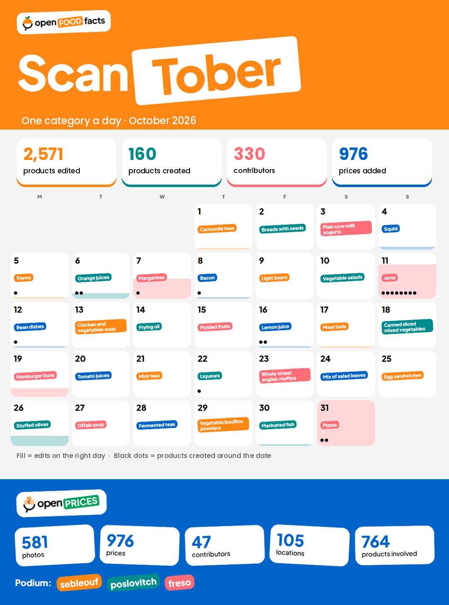

## Goal

Create some stats around the ScanTober challenge.

For the sake of time, dataviz are focused on OpenFoodFacts contributions. Open Prices challenge stats are thus limited to the stats already displayed on the challenge page.

The whole idea was to check the effect of a communication based on "one day - one category" principle.

## Categories
{
	'categories': [
		'en:camomile-teas',
		'en:breads-with-seeds',
		'en:plain-cow-milk-yogurts',
		'en:squid',
		'en:stews',
		'en:orange-juices',
		'en:margarines',
		'en:bacon',
		'en:light-beers',
		'en:vegetable-salads',
		'en:jams',
		'en:bean-dishes',
		'en:chicken-and-vegetables-soup',
		'en:frying-oil',
		'en:pickled-fruits',
		'en:lemon-juice',
		'en:meat-balls',
		'en:canned-diced-mixed-vegetables',
		'en:hamburger-buns',
		'en:tomato-juices',
		'en:mint-teas',
		'en:liqueurs',
		'en:whole-wheat-english-muffins',
		'en:mix-of-salad-leaves',
		'en:egg-sandwiches',
		'en:stuffed-olives',
		'en:offals-soup',
		'en:fermented-teas',
		'en:vegetable-bouillon-powders',
		'en:marinated-fish',
		'en:pizzas'
	]
}
## Relevent fields in product-database dump

created_t
creator
categories_tags
last_modified_by
last_modified_t

**useful params**
Start date : "2026-10-01", start timestamp : 1790812800


## first filter with duckdb (takes a few min)

```sql
COPY (select * from 'food.parquet' where list_has_any(categories_tags, ['en:camomile-teas', 'en:breads-with-seeds', 'en:plain-cow-milk-yogurts', 'en:squid', 'en:stews', 'en:orange-juices', 'en:margarines', 'en:bacon', 'en:light-beers', 'en:vegetable-salads', 'en:jams', 'en:bean-dishes', 'en:chicken-and-vegetables-soup', 'en:frying-oil', 'en:pickled-fruits', 'en:lemon-juice', 'en:meat-balls', 'en:canned-diced-mixed-vegetables', 'en:hamburger-buns', 'en:tomato-juices', 'en:mint-teas', 'en:liqueurs', 'en:whole-wheat-english-muffins', 'en:mix-of-salad-leaves', 'en:egg-sandwiches', 'en:stuffed-olives', 'en:offals-soup', 'en:fermented-teas', 'en:vegetable-bouillon-powders', 'en:marinated-fish', 'en:pizzas'])) TO 'scantober_food.parquet';
```

## Simple stats

Nb of products created during the challenge : 160

```sql
select count(*) from 'scantober_food.parquet' where created_t > 1790812800;
```

Nb of products last edited during the challenge : 2571

```sql
select count(*) from 'scantober_food.parquet' where last_modified_t > 1790812800;
```

### Compared to last month 

Nb of products with same categories created during the previous month : 89

```sql
select count(*) from 'scantober_food.parquet' where created_t < 1790812800 and created_t > 1788220800;
```

Nb of products with same categories last edited during the previous month : 1731

```sql
select count(*) from 'scantober_food.parquet' where last_modified_t < 1790812800 and last_modified_t > 1788220800;
```

**-> Increase is significat enough to attribute it to communication efforts**

### Creation : Product, cat, creation day, creator

```sql
select code, list_intersect(categories_tags, ['en:camomile-teas', 'en:breads-with-seeds', 'en:plain-cow-milk-yogurts', 'en:squid', 'en:stews', 'en:orange-juices', 'en:margarines', 'en:bacon', 'en:light-beers', 'en:vegetable-salads', 'en:jams', 'en:bean-dishes', 'en:chicken-and-vegetables-soup', 'en:frying-oil', 'en:pickled-fruits', 'en:lemon-juice', 'en:meat-balls', 'en:canned-diced-mixed-vegetables', 'en:hamburger-buns', 'en:tomato-juices', 'en:mint-teas', 'en:liqueurs', 'en:whole-wheat-english-muffins', 'en:mix-of-salad-leaves', 'en:egg-sandwiches', 'en:stuffed-olives', 'en:offals-soup', 'en:fermented-teas', 'en:vegetable-bouillon-powders', 'en:marinated-fish', 'en:pizzas']) AS matching_categories, to_timestamp(created_t)::DATE, creator from 'scantober_food.parquet' where created_t > 1790812800;
```

-> 5 creation the exact day of the challenge
-> 19 creations very close (probably related to the challenge)

<details>
<summary>Full list of created products</summary>

|      code      |      matching_categories      | CAST(to_timestamp(created_t) AS "DATE") |           creator            | Scantober link |
|----------------|-------------------------------|-----------------------------------------|------------------------------|----------------|
| 5999863467097  | ['en:pizzas']                 | 2026-10-01                              | mistiquen                    ||
| 8017139123885  | ['en:jams']                   | 2026-10-01                              | tokolo                       ||
| 3452010002814  | ['en:frying-oil']             | 2026-10-01                              | jusdekiwi                    ||
| 17893000632073 | ['en:pizzas']                 | 2026-10-01                              | smoothie-app                 ||
| 0748276567543  | ['en:jams']                   | 2026-10-02                              | openfoodfacts-contributors   ||
| 4056489768159  | ['en:meat-balls']             | 2026-10-02                              | vempele                      ||
| 4070757166645  | ['en:pizzas']                 | 2026-10-02                              | smoothie-app                 ||
| 7801930013282  | ['en:pizzas']                 | 2026-10-02                              | nutria-chile                 ||
| 0898271007411  | ['en:jams']                   | 2026-10-03                              | macrofactor                  ||
| 7898948044230  | ['en:jams']                   | 2026-10-03                              | palringo                     ||
| 7315122014280  | ['en:jams']                   | 2026-10-03                              | smoothie-app                 ||
| 4068262109707  | ['en:jams']                   | 2026-10-04                              | kiliweb                      ||
| 4068262109691  | ['en:jams']                   | 2026-10-04                              | kiliweb                      ||
| 7497517199915  | ['en:bacon']                  | 2026-10-04                              | zobeloo                      ||
| 24102964       | ['en:jams']                   | 2026-10-04                              | gaker79                      ||
| 9323450010018  | ['en:stews']                  | 2026-10-05                              | openfoodfacts-contributors   | <- correct day |
| 2100036001984  | ['en:pizzas']                 | 2026-10-05                              | grgrie                       ||
| 5290148000696  | ['en:lemon-juice']            | 2026-10-05                              | alexiscy                     ||
| 5298005890015  | ['en:camomile-teas']          | 2026-10-05                              | alexiscy                     ||
| 4068262100230  | ['en:pizzas']                 | 2026-10-05                              | kiliweb                      ||
| 3559500002429  | ['en:jams']                   | 2026-10-06                              | org-royal-bourbon-industries ||
| 3559500002467  | ['en:jams']                   | 2026-10-06                              | org-royal-bourbon-industries ||
| 3559500002450  | ['en:jams']                   | 2026-10-06                              | org-royal-bourbon-industries ||
| 3559500002443  | ['en:jams']                   | 2026-10-06                              | org-royal-bourbon-industries ||
| 3559500002436  | ['en:jams']                   | 2026-10-06                              | org-royal-bourbon-industries ||
| 3559500002474  | ['en:jams']                   | 2026-10-06                              | org-royal-bourbon-industries ||
| 3559500001521  | ['en:jams']                   | 2026-10-06                              | org-royal-bourbon-industries ||
| 4335619450929  | ['en:pizzas']                 | 2026-10-06                              | nasar78613                   ||
| 5901529126705  | ['en:orange-juices']          | 2026-10-07                              | smoothie-app                 | <- 1 day late |
| 8008660165048  | ['en:jams']                   | 2026-10-07                              | smoothie-app                 ||
| 3700091904047  | ['en:pizzas']                 | 2026-10-07                              | kiliweb                      ||
| 7981697811014  | ['en:jams']                   | 2026-10-07                              | smoothie-app                 ||
| 2801546004853  | ['en:bacon']                  | 2026-10-07                              | smoothie-app                 ||
| 8480017137661  | ['en:jams']                   | 2026-10-08                              | exfatfoodguy                 ||
| 7793046998464  | ['en:jams']                   | 2026-10-08                              | exfatfoodguy                 ||
| 1270568603718  | ['en:meat-balls']             | 2026-10-09                              | kiliweb                      ||
| 3608580162476  | ['en:jams']                   | 2026-10-09                              | o7zflgzw4vszlm               ||
| 4750192732185  | ['en:breads-with-seeds']      | 2026-10-09                              | ivanovlv                     ||
| 8032974018356  | ['en:jams']                   | 2026-10-09                              | smoothie-app                 ||
| 8420878641372  | ['en:pizzas']                 | 2026-10-09                              | kiliweb                      ||
| 7070841007301  | ['en:jams']                   | 2026-10-09                              | odinh                        ||
| 7070841007318  | ['en:jams']                   | 2026-10-09                              | odinh                        ||
| 5203278064162  | ['en:orange-juices']          | 2026-10-10                              | userman                      | <- 4 days late |
| 5907631202467  | ['en:jams']                   | 2026-10-10                              | trangoul                     | <- 1 day early |
| 0248459903880  | ['en:pizzas']                 | 2026-10-11                              | qualityofvoid7               ||
| 8000633052966  | ['en:jams']                   | 2026-10-11                              | smoothie-app                 | <- correct day |
| 4009233008094  | ['en:pizzas']                 | 2026-10-11                              | dani6630                     ||
| 3250393485510  | ['en:bacon']                  | 2026-10-11                              | kiliweb                      ||
| 8594071235048  | ['en:bean-dishes']            | 2026-10-11                              | smoothie-app                 | <- 1 day early |
| 91210271       | ['en:margarines']             | 2026-10-12                              | smoothie-app                 | <- 5 days late |
| 4002084010629  | ['en:pizzas']                 | 2026-10-12                              | hellodarkness                ||
| 29548743       | ['en:bacon']                  | 2026-10-12                              | macrofactor                  | <- 4 days late |
| 8595678430867  | ['en:jams']                   | 2026-10-13                              | jancz                        | <- 2 days late |
| 8436015961326  | ['en:jams']                   | 2026-10-13                              | smoothie-app                 | <- 2 days late |
| 8901689702082  | ['en:jams']                   | 2026-10-13                              | smoothie-app                 | <- 2 days late |
| 3389681003089  | ['en:jams']                   | 2026-10-13                              | palaeksa                     | <- 2 days late |
| 5060183363434  | ['en:jams']                   | 2026-10-14                              | davidbenes1                  | <- 3 days late |
| 8994016001415  | ['en:jams']                   | 2026-10-14                              | sayaivan                     | <- 3 days late |
| 5202576872424  | ['en:camomile-teas']          | 2026-10-15                              | alexiscy                     ||
| 3701696800758  | ['en:hamburger-buns']         | 2026-10-15                              | moon-rabbit                  ||
| 4000582030590  | ['en:pizzas']                 | 2026-10-15                              | showmaster                   ||
| 4901117522064  | ['en:lemon-juice']            | 2026-10-16                              | qualityofvoid7               | <- correct day |
| 49780345       | ['en:lemon-juice']            | 2026-10-17                              | qualityofvoid7               | <- 1 day late |
| 4280001603011  | ['en:jams']                   | 2026-10-17                              | lebensmittel-lupe-app        ||
| 2606338014894  | ['en:breads-with-seeds']      | 2026-10-17                              | fgouget                      ||
| 2606338010308  | ['en:breads-with-seeds']      | 2026-10-17                              | fgouget                      ||
| 2606338017123  | ['en:breads-with-seeds']      | 2026-10-17                              | fgouget                      ||
| 91214473       | ['en:margarines']             | 2026-10-17                              | onimeno                      ||
| 5290008008015  | ['en:pizzas']                 | 2026-10-17                              | open-prices                  ||
| 8058045980025  | ['en:pizzas']                 | 2026-10-17                              | giaguar                      ||
| 2606338012333  | ['en:breads-with-seeds']      | 2026-10-18                              | fgouget                      ||
| 4901306024232  | ['en:tomato-juices']          | 2026-10-18                              | qualityofvoid7               ||
| 8050030230177  | ['en:jams']                   | 2026-10-18                              | smoothie-app                 ||
| 5390742007524  | ['en:jams']                   | 2026-10-19                              | jmc88                        ||
| 8056138100008  | ['en:pizzas']                 | 2026-10-20                              | davide-murrau                ||
| 3800040806337  | ['en:jams']                   | 2026-10-20                              | vrub4o                       ||
| 6111250479868  | ['en:jams']                   | 2026-10-21                              | smoothie-app                 ||
| 8726900068866  | ['en:pizzas']                 | 2026-10-21                              | talbrecht                    ||
| 7340191187351  | ['en:jams']                   | 2026-10-21                              | akitainu                     ||
| 5290003009734  | ['en:orange-juices']          | 2026-10-21                              | open-prices                  ||
| 5290011002482  | ['en:tomato-juices']          | 2026-10-21                              | open-prices                  ||
| 5290010001424  | ['en:tomato-juices']          | 2026-10-21                              | open-prices                  ||
| 9415077055746  | ['en:margarines']             | 2026-10-22                              | smoothie-app                 ||
| 8410762861603  | ['en:pizzas']                 | 2026-10-22                              | ola2109                      ||
| 4752050200997  | ['en:stews']                  | 2026-10-22                              | ivanovlv                     ||
| 2000000162370  | ['en:lemon-juice']            | 2026-10-22                              | clewis                       ||
| 2606338016539  | ['en:breads-with-seeds']      | 2026-10-23                              | fgouget                      ||
| 7318690748304  | ['en:pizzas']                 | 2026-10-23                              | macrofactor                  ||
| 3760442520135  | ['en:jams']                   | 2026-10-24                              | oliverose                    ||
| 3023480113005  | ['en:liqueurs']               | 2026-10-24                              | open-prices                  | <- 2 days late |
| 2900129002559  | ['en:bacon']                  | 2026-10-24                              | kiliweb                      ||
| 8426963938891  | ['en:jams']                   | 2026-10-25                              | smoothie-app                 ||
| 7023511020025  | ['en:jams']                   | 2026-10-25                              | fredrik-lindseth             ||
| 7070841007820  | ['en:jams']                   | 2026-10-25                              | fredrik-lindseth             ||
| 7071451004001  | ['en:bacon']                  | 2026-10-25                              | fredrik-lindseth             ||
| 7090045940006  | ['en:jams']                   | 2026-10-25                              | fredrik-lindseth             ||
| 7035620055997  | ['en:jams']                   | 2026-10-25                              | fredrik-lindseth             ||
| 7035620066900  | ['en:jams']                   | 2026-10-25                              | fredrik-lindseth             ||
| 7035620069123  | ['en:bacon']                  | 2026-10-25                              | fredrik-lindseth             ||
| 7035620052224  | ['en:jams']                   | 2026-10-25                              | fredrik-lindseth             ||
| 3425471303363  | ['en:jams']                   | 2026-10-25                              | fredrik-lindseth             ||
| 5900919020821  | ['en:jams']                   | 2026-10-25                              | fredrik-lindseth             ||
| 0059471315014  | ['en:jams']                   | 2026-10-25                              | fredrik-lindseth             ||
| 7023511011153  | ['en:jams']                   | 2026-10-25                              | fredrik-lindseth             ||
| 7023511012181  | ['en:jams']                   | 2026-10-25                              | fredrik-lindseth             ||
| 7023511020308  | ['en:jams']                   | 2026-10-25                              | fredrik-lindseth             ||
| 7023511021985  | ['en:jams']                   | 2026-10-25                              | fredrik-lindseth             ||
| 7023511022029  | ['en:jams']                   | 2026-10-25                              | fredrik-lindseth             ||
| 7023511022104  | ['en:jams']                   | 2026-10-25                              | fredrik-lindseth             ||
| 7034280110510  | ['en:pizzas']                 | 2026-10-25                              | fredrik-lindseth             ||
| 7070439008345  | ['en:jams']                   | 2026-10-26                              | fredrik-lindseth             ||
| 7070439008468  | ['en:jams']                   | 2026-10-26                              | fredrik-lindseth             ||
| 7070841005055  | ['en:jams']                   | 2026-10-26                              | fredrik-lindseth             ||
| 7071848108411  | ['en:hamburger-buns']         | 2026-10-26                              | fredrik-lindseth             ||
| 7090007391310  | ['en:bacon']                  | 2026-10-26                              | fredrik-lindseth             ||
| 7090007391358  | ['en:bacon']                  | 2026-10-26                              | fredrik-lindseth             ||
| 7090010730168  | ['en:jams']                   | 2026-10-26                              | fredrik-lindseth             ||
| 7090011156554  | ['en:hamburger-buns']         | 2026-10-26                              | fredrik-lindseth             ||
| 7090022857969  | ['en:hamburger-buns']         | 2026-10-26                              | fredrik-lindseth             ||
| 7090047980550  | ['en:jams']                   | 2026-10-26                              | fredrik-lindseth             ||
| 7090047980581  | ['en:jams']                   | 2026-10-26                              | fredrik-lindseth             ||
| 7090047980857  | ['en:jams']                   | 2026-10-26                              | fredrik-lindseth             ||
| 7090047980888  | ['en:jams']                   | 2026-10-26                              | fredrik-lindseth             ||
| 7090047980918  | ['en:jams']                   | 2026-10-26                              | fredrik-lindseth             ||
| 7090047980970  | ['en:jams']                   | 2026-10-26                              | fredrik-lindseth             ||
| 7090047981106  | ['en:jams']                   | 2026-10-26                              | fredrik-lindseth             ||
| 7090047981182  | ['en:jams']                   | 2026-10-26                              | fredrik-lindseth             ||
| 7090051520094  | ['en:jams']                   | 2026-10-26                              | fredrik-lindseth             ||
| 7090057870049  | ['en:jams']                   | 2026-10-26                              | fredrik-lindseth             ||
| 7090057870056  | ['en:jams']                   | 2026-10-26                              | fredrik-lindseth             ||
| 7090068100067  | ['en:pizzas']                 | 2026-10-26                              | fredrik-lindseth             ||
| 7090068100074  | ['en:pizzas']                 | 2026-10-26                              | fredrik-lindseth             ||
| 8001505006810  | ['en:jams']                   | 2026-10-26                              | fredrik-lindseth             ||
| 8003948100421  | ['en:bacon']                  | 2026-10-26                              | fredrik-lindseth             ||
| 8052080434796  | ['en:pizzas']                 | 2026-10-26                              | fredrik-lindseth             ||
| 4250073464407  | ['en:pizzas']                 | 2026-10-26                              | nougad                       ||
| 8908010958217  | ['en:pickled-fruits']         | 2026-10-26                              | ritikb                       ||
| 3700009287071  | ['en:pizzas']                 | 2026-10-27                              | eblaise                      ||
| 0248460003982  | ['en:pizzas']                 | 2026-10-27                              | qualityofvoid7               ||
| 3700009287088  | ['en:pizzas']                 | 2026-10-27                              | eblaise                      ||
| 3700009287064  | ['en:pizzas']                 | 2026-10-27                              | eblaise                      ||
| 6009533713825  | ['en:lemon-juice']            | 2026-10-28                              | smoothie-app                 ||
| 4610198912632  | ['en:pizzas']                 | 2026-10-28                              | kirillmukhin                 ||
| 7898924646076  | ['en:orange-juices']          | 2026-10-28                              | thiagoassis                  ||
| 2960851004757  | ['en:bacon']                  | 2026-10-30                              | yukiro                       ||
| 0086854034880  | ['en:mint-teas']              | 2026-10-30                              | kjmj                         ||
| 4001724056317  | ['en:pizzas']                 | 2026-10-30                              | blackfatrat                  ||
| 7318690014355  | ['en:camomile-teas']          | 2026-10-31                              | freso                        ||
| 5021991944512  | ['en:camomile-teas']          | 2026-10-31                              | freso                        ||
| 7310186023650  | ['en:camomile-teas']          | 2026-10-31                              | freso                        ||
| 7340083488009  | ['en:camomile-teas']          | 2026-10-31                              | smoothie-app                 ||
| 7311043018888  | ['en:orange-juices']          | 2026-10-31                              | freso                        ||
| 7752705000290  | ['en:orange-juices']          | 2026-10-31                              | patriciosolano               ||
| 8719200316874  | ['en:margarines']             | 2026-10-31                              | freso                        ||
| 7311043006533  | ['en:pizzas']                 | 2026-10-31                              | freso                        | <- correct day |
| 8015673035787  | ['en:pizzas']                 | 2026-10-31                              | smoothie-app                 | <- correct day |
| 7340083469169  | ['en:camomile-teas']          | 2026-10-31                              | freso                        ||
| 7340191140356  | ['en:camomile-teas']          | 2026-10-31                              | freso                        ||
| 7340191164390  | ['en:camomile-teas']          | 2026-10-31                              | freso                        ||
| 6408432003592  | ['en:plain-cow-milk-yogurts'] | 2026-11-01                              | freso                        ||

</details>

### Edition : product, cat, last edit, editor

```sql
COPY (
select code, list_intersect(categories_tags, ['en:camomile-teas', 'en:breads-with-seeds', 'en:plain-cow-milk-yogurts', 'en:squid', 'en:stews', 'en:orange-juices', 'en:margarines', 'en:bacon', 'en:light-beers', 'en:vegetable-salads', 'en:jams', 'en:bean-dishes', 'en:chicken-and-vegetables-soup', 'en:frying-oil', 'en:pickled-fruits', 'en:lemon-juice', 'en:meat-balls', 'en:canned-diced-mixed-vegetables', 'en:hamburger-buns', 'en:tomato-juices', 'en:mint-teas', 'en:liqueurs', 'en:whole-wheat-english-muffins', 'en:mix-of-salad-leaves', 'en:egg-sandwiches', 'en:stuffed-olives', 'en:offals-soup', 'en:fermented-teas', 'en:vegetable-bouillon-powders', 'en:marinated-fish', 'en:pizzas']) AS matching_categories, to_timestamp(last_modified_t)::DATE as dt, last_modified_by from 'scantober_food.parquet' where last_modified_t > 1790812800
) TO 'scantober_edits.csv' (HEADER, DELIMITER ',');
```

Then script find_relevent_edits.py is run, which generates edits_on_correct_day.csv

-> 96 edits on correct day


## With these data, claude is prompted for dataviz generation

### Prompt

As part of the Scantober initiative, Open Food Facts invited its contributors to focus their efforts on one product category each day throughout October. Alongside this initiative, an Open Prices challenge encouraged contributors to add prices for products belonging to the same categories.

Help me build a website featuring data visualizations to summarize both projects.

Design considerations:

- Avoid Claude's standard layout and color palette.
- Instead, take inspiration from the fun, playful side of the Open Food Facts brand identity.
- The website https://openfoodfacts.github.io/openfoodfacts-design/ contains design inspiration and SVG assets that you can use.
- The attached Brand Guidelines document is also a source of inspiration.
- The primary deliverable should be a website. A second deliverable in the form of a static image could also be considered.
- A calendar-based layout is one possibility, but feel free to be creative and explore the best way to visualize the data.
- If needed, product pages can be linked using the following URL format: https://world.openfoodfacts.org/product/xxxxx, replacing xxxxx with the relevant product code, to provide more information about newly created or edited products.

Content to display (provided in no particular order — feel free to organize it as you see fit):

- Cat_dates.json contains the list of categories and their corresponding dates.
- edits_on_correct_day.csv contains the products edited on the correct day, along with the contributor's name.
- product_created_near_day.md contains a list of new products added to Open Food Facts around the corresponding days.
- 160 products across the relevant categories were created during the challenge by 55 different contributors.
- 2,571 products across the relevant categories were edited during the challenge by 328 contributors.
- Open Prices Challenge statistics: 581 photos, 976 prices, 47 contributors, 105 locations, 764 products covered
- Top Open Prices contributors: sebleouf, freso, poslovitch.

### Manual changes after

* Some fixes with photoshop on the image
* Some UI tweaks on the html

### results in dataviz folder




## Open Prices check

* `retrieve_challenge_prices.py` fetches all prices from challenge using API, and creates `prices.json`
* `find_relevent_prices.py` looks at prices created for the correct category, on the correct day, and creates `prices_on_correct_day.csv`

### Results

* prices: 976
* Created on the correct day : 105
* Created after the correct day : 334

Most of the prices created on the correct day are pizzas, but it's a side effect of it being the last challenge day and contributors rushing to upload all pictures.

Besides that, we do have a small list of contributions that were most likely related to the ScanTober daily communication

| code | category | day | contributor | tool used to add price |
| ------------- | ------ | --- | --- | --- |
| 8410234621148 | en:squid | 2026-10-04 | sebleouf | Open Prices Web App - /prices/add/validate |
| 8410234601140 | en:squid | 2026-10-04 | sebleouf | Open Prices Web App - /prices/add/validate |
| 3256220426657 | en:squid | 2026-10-04 | sebleouf | Open Prices Web App - /prices/add/validate |
| 4337256995788 | en:stews | 2026-10-05 | jangop | API |
| 4337256983945 | en:stews | 2026-10-05 | jangop | API |
| 3560070820542 | en:orange-juices | 2026-10-06 | poslovitch | Open Prices Web App - /prices/add/validate |
| 3123349011227 | en:orange-juices | 2026-10-06 | poslovitch | Open Prices Web App - /prices/add/validate |
| 3560070823246 | en:orange-juices | 2026-10-06 | poslovitch | Open Prices Web App - /prices/add/validate |
| 7038010073090 | en:orange-juices | 2026-10-06 | odinh | Open Prices Web App - /experiments/proof-price-tag-assistant |
| 3154230026181 | en:bacon | 2026-10-08 | sebleouf | Open Prices Web App - /prices/add/validate |
| 5907631202467 | en:jams | 2026-10-11 | trangoul | Smoothie - OpenFoodFacts (4.24.0+1614) (ios+Version 27.2 (Build 24B5089g)) |
| 0671890101346 | en:jams | 2026-10-11 | doby | Open Prices Web App - /experiments/proof-price-tag-assistant |
| 3448550005040 | en:jams | 2026-10-11 | alexiscy | Open Prices Web App - /prices/add/validate |
| 3450971459500 | en:hamburger-buns | 2026-10-19 | chevalstar | Open Prices Web App - /experiments/receipt-assistant |
| 3560070105908 | en:stuffed-olives | 2026-10-26 | sebleouf | Open Prices Web App - /prices/add/validate |
| 3560070105878 | en:stuffed-olives | 2026-10-26 | sebleouf | Open Prices Web App - /prices/add/validate |